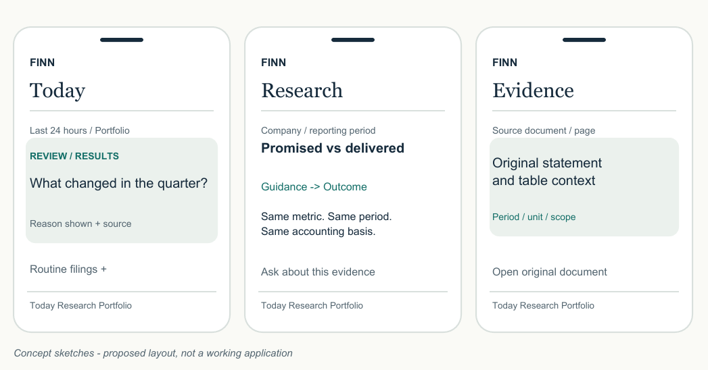
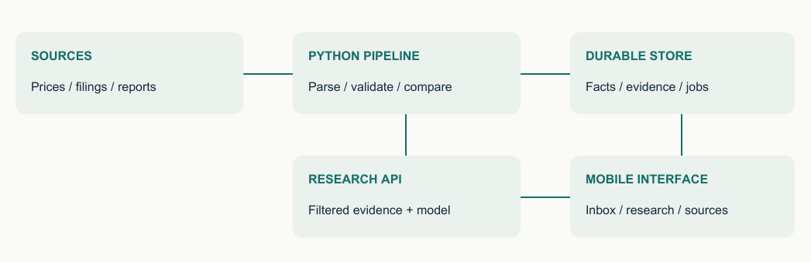

# FINN
## An investor's attention, well spent.

**Project blueprint for the ENAM Holdings AI Engineer Build Challenge**

Prepared 27 October 2026 | Submission deadline: 1 November 2026

**Recommendation:** build a mobile portfolio inbox that identifies consequential changes, connected to a primary-source research view that compares management's promises with delivery. Make the transition from alert to evidence to investigation exceptionally clear.

The strongest submission will demonstrate judgment: what deserves attention, what can be collapsed, what the evidence supports, and when the system should abstain. A small product with two complete workflows will communicate this better than a large collection of financial dashboards.

### The two experiences to perfect

1. **Brief me.** In under a minute, understand the important changes across an 18-company mock portfolio. Inspect the evidence, acknowledge an item, and tune the alerts.
2. **Check the story.** Research a company through its annual reports and earnings-call transcripts. See explicit guidance, subsequent revisions, comparable actual outcomes, and the unanswered question that remains.

### The submission we are aiming for

A working phone-friendly application, a reproducible GitHub repository, genuine AI build history, and a short covering email. Add a concise recorded walkthrough and a small evaluation report as supporting evidence. The recording supplements the live application.

### Planning assumptions

One builder, assisted by coding tools; approximately 45-55 focused hours across 27 October-1 November. A responsive web application is the fastest distribution route. No paid service is purchased by this plan. Model and hosting budgets below are estimates and choices for implementation.

This document is a researched implementation plan. The application, data pipeline, benchmarks, and performance targets described here have not yet been built or measured. Design sketches are concepts, not screenshots of a working system.

### Reading map

Brief and strategy: sections 1-2. Experience and scope: 3-6. Financial correctness and data: 7-11. Architecture and delivery: 12-19. References: 20-21.

<!-- page -->

## 1. What the challenge actually asks for

The main brief frames the problem as filtering information for a lean, high-conviction investment team. It explicitly gives freedom over interaction and design, makes the eight research outputs a menu, and prioritises a working narrow prototype over broad coverage. [B1, pp. 1-4]

| Requirement | Implementation commitment | Proof to show |
| --- | --- | --- |
| Mobile-first working prototype | Responsive web link; useful without installation | Test on a real phone and at 360px width |
| Push and pull interaction | Portfolio inbox plus company research | Complete both journeys during the demo |
| 15-20 portfolio companies | 18 mock holdings across multiple sectors and business sizes | Visible editable portfolio; no claim these are Enam holdings |
| 3-5 research examples | Four prepared companies; one may be outside the portfolio | Research opens with documents and citations |
| Generalise beyond demo names | Security-master lookup and generic document discovery | Fresh, uncached NSE ticker test |
| Three data sources | EOD prices/volume, exchange filings, annual reports/transcripts | Source inventory and refresh status |
| Primary-source pull analysis | Annual reports and call transcripts as research corpus | Every substantive claim points to source evidence |
| GitHub repository | Setup, architecture, limitations, tests, sample configuration | Another person can run it |
| AI build history | Authentic conversation exports/share links and decision notes | Navigable index; secrets removed |
| Covering email | What we built, choices, trade-offs, omissions, next steps | Links and attachments checked |

**Exact submission details:** send to **assessment@enam.com**, subject **ENAM - IIT screening - 2027**. The deadline is **Sunday, 1 November 2026**. The brief gives no exact time or timezone. Use **31 October, 18:00 IST** as our internal readiness target; this is our buffer, not an organiser-stated cutoff. [B1, pp. 1, 4]

### Examples we choose to implement

The windowed digest, configurable alerts, quarterly results card, and management background enrichment are examples in the brief rather than a mandatory exhaustive checklist. We adopt the first three and keep background enrichment as a small enhancement. Likewise, we select business snapshot, guidance, and narrative-versus-numbers as the research core. Cash quality is a valuable addition if the core is reliable.

The reference taxonomy is orientation, not an instruction to assign priority mechanically. An auditor-related disclosure cannot safely be buried merely because the reference groups routine auditor appointments with low-relevance paperwork. Read the event. [B2, pp. 1-3]

<!-- page -->

## 2. Design for this firm

Enam Holdings describes investing its own unlevered capital, conducting fundamental company research, and focusing on management quality and governance. Its investment philosophy also emphasises capital preservation, capital allocation, and long-term ownership. These are firm statements; the product implications below are our interpretation. [S01, S02]

| Firm context | Product implication |
| --- | --- |
| Long-term ownership | Give changes in business economics and management commitments priority over constant price movement |
| Management and governance matter | Connect leadership changes, auditor concerns, capital allocation and guidance delivery |
| Granular company research | Make it easy to inspect original documents and distinguish consolidated from standalone numbers |
| A lean investment team | Reduce reading and repeated document hunting; preserve a visible audit trail |
| Independent judgment | Separate reported facts, management explanations and FINN's interpretation |

**Positioning:** FINN helps an investor maintain and challenge a view of a business as new evidence arrives. It should feel like a calm research instrument. Avoid trade execution, return forecasts and buy/sell scores: those add little proof of the building ability this challenge seeks.

### What existing products teach us

**Koyfin:** its mobile product highlights access to watchlists while away from a desk. Borrow the idea of continuity and quick inspection. Do not reproduce a terminal's density on a phone. [S03]

**AlphaSense:** its research interface links generated answers to exact sources. Treat evidence inspection as a primary interaction. FINN's opportunity is a much narrower portfolio-to-management-guidance workflow tailored to this brief. This is a proposed distinction, not a claim that competitors lack similar capabilities. [S04]

**Screener:** its company page exposes annual-report and concall links. Use it as a discovery directory. Do not pass Screener's generated pros/cons, AI summaries or normalised financial tables into the pull model as primary evidence. [S05]

### Our central product decision

Use an **inbox plus evidence workspace**. Chat remains a contextual action inside a company or filing. The first screen already does useful work before the investor types a prompt. One tap moves from a relevant event into a focused question such as whether management's margin commentary matches the reported outcome.

These choices align with the brief's emphasis on filtering, concision, creativity and judgment. They are a strategic recommendation, not a prediction of the judges' rankings.

<!-- page -->

## 3. The experience, end to end

### Morning: understand the changes

The investor opens **Today**. A visible time window defaults to the last 24 hours and offers 7 days and a custom range. The page shows relevant events first, followed by a collapsed routine section. The summary reports retrieved filing counts and source coverage, not an unsupported claim that every exchange disclosure was captured.

Each card answers four questions: **what changed; why it is shown; what evidence supports it; what can I do next?** Display event time, source, company, and a clear priority label. An event without sufficient evidence remains a source-linked filing with an extraction warning.

### After results: move from surprise to understanding

Tap a results card to inspect the current quarter, prior quarter and prior-year quarter. Tap a number to see its source page, original unit and calculation. Select **Check management's guidance** to open the relevant company and period. Preserve the original card and scroll position when returning.

### On demand: inspect a company

In **Research**, search by NSE ticker or company name. The engine resolves the entity, discovers permitted documents and reports its coverage. For an uncached company, show named stages: finding reports, reading documents, checking comparisons. Show partial results as they become validated; never stream speculative conclusions.

The first research screen contains a short business snapshot, a guidance-versus-delivery timeline, and at most three questions worth investigating. A contextual question box supports follow-ups grounded in the same documents.

### Three navigation destinations

| Destination | Main job | Key controls |
| --- | --- | --- |
| Today | Review the portfolio's important changes | Window, priority, routine items, acknowledged items |
| Research | Understand a company and challenge its story | Company search, period, evidence, follow-up |
| Portfolio | Manage mock holdings and monitoring | Add/remove company, category preferences, price/volume thresholds |

**Small distinctive interaction:** a **Since I last checked** filter based on the investor's last acknowledgement, with the actual date range visible. It must not override the default 24-hour window or hide an unacknowledged high-priority item.

**Finishing action:** mark a finding reviewed or save a question for later. Persist per-session state for the demo so one evaluator does not change another evaluator's settings. Full team collaboration can wait.

<!-- page -->

## 4. Visual direction and screen concepts

**Direction: a quiet financial briefing.** Use an ink/navy foreground, warm off-white canvas, restrained teal accent, and amber for attention. Reserve red for a negative value or explicit risk state. Priority and meaning must also be written in text.

Use a characterful serif only for the FINN wordmark and occasional section title; use a highly legible sans serif for working content. Align numbers with tabular numerals. Design on a 4px spacing scale with 16px mobile margins, 16px body text, readable source labels and approximately 44px controls. WCAG 2.2 AA's minimum target criterion is 24 CSS pixels with exceptions; our 44px target is a more generous product choice. [S06]

### Layout and interaction rules

1. **One decision per card.** Headline, one explanation, a compact evidence row and one primary action. Keep the initial narrative to roughly 45-65 words.
2. **Progressive disclosure.** Evidence opens in a bottom sheet on mobile and a side panel on desktop. Keep the company and reporting period visible in the sheet header.
3. **Mobile financial tables.** Show the current value and changes first; expand the comparison periods beneath each metric. Avoid a six-column desktop table squeezed onto a phone.
4. **Honest states.** Distinguish no filings, unavailable feed, stale data, no transcript, not-yet-due guidance and incomparable metrics. A blank screen must not imply a clean bill of health.
5. **Purposeful motion.** Brief transitions preserve orientation; honour reduced-motion settings. No pulsing AI orb, rotating headline ticker or decorative price chart.
6. **Accessible controls.** Visible focus, labelled icons, keyboard operation, adequate contrast, and no hover-only evidence. A swipe action always has a visible button alternative.

The concepts above show proposed layout only. Any illustrative counts or labels in them are design placeholders. The Infosys comparison in section 9 is the separately verified historical example.

<!-- page -->

## 5. Scope that protects the strongest work

| Tier | Build | Acceptance boundary |
| --- | --- | --- |
| Essential | 18-company portfolio, EOD prices/volume, exchange filing ingestion | Visible timestamps, actual data, failure states |
| Essential | Windowed prioritised inbox and routine section | 24h, 7d and custom range; all retrieved items accessible |
| Essential | Configurable in-app category and price/volume alerts | Saved thresholds; repeat processing does not duplicate alerts |
| Essential | Results extraction card | Four headline metrics where meaningful; absent figures explicit |
| Essential | Company resolution and generic document discovery | Unprepared ticker can use the same pipeline |
| Essential | Primary-source research and guidance comparison | Evidence links; matching periods and bases; abstention |
| Essential | Deployment, reproducible repo and AI history | Reviewer can open and run the product |
| Next | Cash-quality panel | Annual CFO/PAT and FCF with calculation evidence |
| Next | Incoming executive background | Public company biography or appointment filing; sources shown |
| Next | Since-last-check, saved question, installable PWA | Only after essential journeys pass |
| Deferred | Voice, native apps, WhatsApp/email alerts, broker integration | Adds distribution and permissions work without strengthening the core |
| Deferred | Full valuation engine, trading signals, all eight research sections | Too broad for the available time |
| Deferred | Autonomous multi-agent research and separate vector infrastructure | Add only when measured failures justify them |

### Depth allocation

Monitor prices and filings across all 18 holdings. Prepare a rich research corpus for four companies. Build document discovery for any supported NSE symbol; do not restrict the underlying parser, prompts or calculations to the prepared names.

For results, make a generic extractor and validate it on a deliberately varied small set. Do not claim universal financial-statement coverage. For banks, use reported financial-sector metrics and show EBITDA as not applicable, rather than forcing an industrial-company template.

### Scope-cut order

If time tightens, remove native/browser notifications, executive enrichment, additional charts and the cash-quality panel in that order. Keep evidence, fresh ticker support, source-health states and the live deployment. Do not preserve decorative features by quietly replacing general research with hard-coded reports.

**Time discipline:** allocate approximately one quarter of build effort to the data connection and extraction foundation, one quarter to research correctness, one quarter to the mobile journeys, and one quarter to integration, testing and submission. Shift time based on the first deployed slice, not ambition alone.

<!-- page -->

## 6. Push: turn a filing feed into an attention queue

### Ingestion and grouping

Ingest exchange announcements, resolve the company, retain publication and fetch timestamps, download permitted attachments, and identify duplicates. An NSE/BSE copy of the same filing becomes one event with both source links. Group a results release, accompanying presentation and transcript under the same event when appropriate; retain each original document.

Do not collapse a later correction as a duplicate. Track document hashes and revisions. A corrected result can invalidate a calculation and trigger a clearly labelled update.

### An explainable priority policy

Start with three tiers, not a pseudo-precise AI significance score. The rules below are our proposed product policy and must be tested against labelled examples.

| Tier | Typical evidence | Presentation |
| --- | --- | --- |
| Review | Published results; CEO/CFO resignation; auditor concern; material transaction; default or adverse regulatory order | Prominent card with reason and source |
| Track | Guidance update; substantive capex; rating change; cash distribution; unusual EOD price/volume | Compact card, elevated by user preference or a verified thesis link |
| Routine | Meeting notice; newspaper results advertisement; ordinary compliance certificate; duplicate attachment | Collapsed but searchable and countable |

A title containing "results" is not enough: distinguish a future board meeting from published financial results. Separate raising capital from returning capital even if both originate in the reference's fund_raise category. A negative governance disclosure overrides a routine category. Unknown materiality remains visible rather than being silently demoted.

### Alerts with exact definitions

- Price move: `100 x (close_t / close_previous_trading_day - 1)`; fire when its absolute value exceeds the user's threshold. Display the direction and price basis.
- Volume ratio: `volume_t / mean(volume_previous_20_completed_sessions)`; exclude today's volume from the denominator. Default to 2.0x, configurable. If history is incomplete or the denominator is zero, abstain or label the shorter window explicitly.
- Check corporate actions before flagging a price anomaly. Suppress or mark comparisons distorted by splits/bonuses; do not silently mix adjusted and raw prices.
- Store a deduplication key containing company, event/session, rule and rule version. A preference edit can preview historical matches without presenting them as new live events.

Poll filings at a modest documented interval, provisionally 15 minutes, subject to source access. EOD alerts run after a completed session's data becomes available. In-app push satisfies the proactive interaction; do not promise instantaneous exchange alerts or intraday price monitoring.

<!-- page -->

## 7. Results: accuracy before attractive numbers

The brief's four headline metrics are Revenue, EBITDA, PBT and PAT, compared QoQ and YoY. Store each observed value with company, period start/end, duration, currency, scale, consolidation basis, source page and original label. Retain both raw and normalised values. [B1, p. 2; B2, p. 2]

### Extraction sequence

1. Locate the actual financial statement and identify standalone versus consolidated tables. Prefer consolidated consistently when available.
2. Extract the current quarter and comparable prior quarter/prior-year quarter. Do not mistake a six-month cumulative column for a quarter.
3. Normalise units. For example, INR 1 million equals INR 0.1 crore; keep the displayed original scale in evidence.
4. Validate signs, period labels, entity scope and arithmetic. Record restated comparatives and use a consistent version.
5. Calculate changes in code using decimal arithmetic. Let the model explain the validated output, not invent missing inputs.

### Required financial edge cases

**EBITDA:** show a directly reported figure if available, labelled as reported or adjusted. If derived, disclose the exact components and treatment of other income and exceptional items. Do not assume PBT + interest + depreciation equals operating EBITDA for every company. If a comparable basis cannot be established, show unavailable.

**PAT:** distinguish total consolidated profit from profit attributable to owners. Use the same definition in comparisons. Do not silently substitute one for the other.

**Growth:** for a positive prior-period base, use `(current - prior) / prior x 100`. For zero or negative bases, show the absolute change and a loss-to-profit/profit-to-loss label instead of a misleading percentage. Margin changes should be in percentage points or basis points, not generic percent.

**Quarter four:** some filings present annual and nine-month values. Derive Q4 only when the periods, scope and accounting basis match, and label the subtraction. Otherwise leave the quarter absent.

**Financial firms:** an EBITDA panel is often inappropriate for a bank. Render a sector-aware card using disclosed banking metrics where supported, while explicitly marking the requested metric not applicable.

### Evidence is part of the number

Tapping a result opens its table context, source page, unit, original period label and formula. Validation labels should say **source matched**, **derived**, **incomparable** or **unavailable**. Do not display an uncalibrated confidence percentage.

<!-- page -->

## 8. Pull: the management promise ledger

This is the signature feature. Build a temporal record of what management explicitly expected, how that expectation changed, and what later evidence establishes. The latest four available quarterly calls are the default review window, with document coverage displayed.

### A guidance record must retain

Company; speaker and role; statement date; source document/page; short supporting excerpt; metric; target period; numeric value or range; unit; reported versus constant-currency basis; consolidated/segment scope; explicit guidance versus qualitative commentary; conditions; and links to previous revisions.

An analyst's question is not management guidance. An aspiration without a date is not a missed commitment. A target for a fiscal year must not be graded against one quarter. An already-known outcome must not leak into an earlier "as of" assessment.

### Comparison rules

| State | Rule |
| --- | --- |
| Within range | Comparable outcome falls inside the stated range |
| Below / above range | Comparable outcome lies outside it; show the distance to the nearest boundary |
| Pending | Target period has not ended, or the relevant outcome has not been published |
| Revised / withdrawn | Preserve the old statement and link the later change |
| Not comparable | Metric, currency, accounting basis, scope or period differs |
| No explicit guidance found | No qualifying statement in the documents searched; show coverage |

For capex or leverage, above target is not automatically good. Keep directional comparison separate from investment interpretation. For qualitative commentary, offer a supported observation and counterevidence rather than inventing a numeric hit rate.

### Research response shape

Start with a one-sentence answer. Follow with at most three findings, each backed by evidence. Show the management statement and measured outcome side by side, identify the period and basis, and end with the most useful remaining question. Put longer supporting detail behind expansion.

**Strict source boundary:** use annual reports and call transcripts for pull conclusions. Quarterly result filings support push cards. If a recent outcome has not yet appeared in the allowed pull corpus, mark it pending there and link to the separately labelled results card. This conservative separation follows the brief's explicit research discipline; expanding the pull corpus to other company disclosures should be a documented choice rather than an unnoticed shortcut.

<!-- page -->

## 9. A verified example worth demonstrating

**Historical validation case: Infosys, FY2025.** This is a researched fixture, not a claim about the current quarter or current investment attractiveness.

| Evidence | What it establishes |
| --- | --- |
| Q3 FY25 earnings call, 16 January 2025, printed p. 4; repeated on p. 7 | Management raised FY25 revenue growth guidance to 4.5-5.0% in constant currency and retained 20-22% operating-margin guidance. [S07] |
| Q4 FY25 earnings call, 17 April 2025, printed p. 3 | Management reported FY25 constant-currency revenue growth of 4.2% and operating margin of 21.1%. [S08] |
| Our calculation | Revenue growth was 0.3 percentage points below the lower bound; margin was within the guided range. |

### The product should say

**Revenue growth finished below the January guidance range; operating margin finished within range.** The evidence concerns FY25 constant-currency revenue growth and full-year operating margin. It does not establish that management is generally unreliable or explain a share-price move.

### Why this is a strong test

The annual report also presents INR revenue growth of 6.1%, while the comparable constant-currency growth is 4.2%. A careless system could compare 6.1% with a 4.5-5.0% constant-currency target and falsely report an outperformance. That is exactly the kind of error our metric-basis checks must prevent. [S09]

The Q4 call explains a larger-than-expected reduction in third-party revenue and seasonal factors. Attribute this as management's explanation; do not elevate it to independently established causation. [S08]

### Extend the example into the real demo

Ingest the four latest available quarterly calls at build time, then show each target's actual status. As of this research, Screener's Infosys page displayed an October 2026 concall entry without the same linked transcript presentation as several prior entries. This is a discovery observation, not proof no transcript exists elsewhere. The engine should check company IR and reveal missing coverage. [S05]

Keep the FY25 example as a labelled historical replay and regression test. Live mode must use live dates and current source status. Never relabel old events as today's news to make the inbox appear more interesting.

<!-- page -->

## 10. Data acquisition and provenance

| Need | Primary route | Fallback and boundary |
| --- | --- | --- |
| Security identity | NSE securities master and symbol-change records [S10] | Explicit alias mapping; require company/ISIN agreement |
| EOD price and volume | yfinance, as suggested by the brief [S11, S12] | Permitted exchange daily report download; retain provider and adjustment basis |
| Corporate filings | NSE announcement page and official RSS discovery [S13, S14] | BSE public page/attachment or company IR copy; disclose coverage gaps |
| Annual reports and transcripts | Company IR pages; Screener document links [S05, S15] | Exchange-hosted copy; known-source URL upload as a recovery path |
| Executive enrichment | Appointment filing or official company biography | Public professional source only when available; separate from pull corpus |

NSE exposes an announcement interface with date filters and attachments, and an official RSS page covering several corporate-information categories. RSS is a discovery channel, not proof of complete historical coverage. Backfill and cross-check the chosen window. Do not assume an undocumented endpoint is a stable public API. [S13, S14]

The BSE announcements page returned a 403 to this research tool. That demonstrates a practical access risk in this environment; it does not establish that every deployment will be blocked. Test the actual hosted environment on the first build day. Stop at access controls and use an authorised/public alternative.

### Document provenance contract

Save original URL, final URL, publisher, company identity, source class, publication date, fetch time, report period, file hash, revision status, extraction method and page mapping. Store the original PDF in object storage where use is permitted. A citation must resolve to both a document and a supporting passage/table, not merely a company homepage.

Use public search only to discover authoritative documents. Do not give search snippets, news, broker notes or model memory to the pull synthesis step. A user's pasted URL must pass URL, publisher and company validation before ingestion.

**Operational boundary:** the yfinance project identifies Yahoo data as intended for personal use and directs users to Yahoo's terms. The challenge's suggestion is sufficient to evaluate that route for a prototype, not a production redistribution licence. Record this dependency and review permitted use before a broader rollout. [S11]

<!-- page -->

## 11. Demo coverage and unfamiliar companies

### Proposed mock portfolio: 18 companies

These are proposed demonstration candidates, not Enam's holdings or investment recommendations. Validate listing status, symbols, document access and current size diversity against the security master before freezing the set. Sector labels below are descriptive, not current market-cap classifications.

| Sector / business | Candidate NSE symbols | What it helps demonstrate |
| --- | --- | --- |
| Banking | HDFCBANK, ICICIBANK | Sector-aware financial presentation |
| IT services | INFY, PERSISTENT | Guidance, currency basis and transcript depth |
| Telecom | BHARTIARTL | Capital intensity and operating commentary |
| Engineering / industrial | LT, ELECON | Projects, orders and execution |
| Electrical / building products | POLYCAB, ASTRAL, CERA | Margins, capex and working capital |
| Automotive | MARUTI, EICHERMOT | Volume versus value, cyclical comparisons |
| Pharmaceuticals | SUNPHARMA, CIPLA | Regulatory and business-mix disclosures |
| Specialty materials | PIDILITIND | Input costs and margins |
| Power | TATAPOWER | Funding, capex and project progress |
| Electronics manufacturing | DIXON | Growth, concentration and cash conversion |
| Textiles | KPRMILL | Capacity and different business scale |

**Prepared research set:** INFY, POLYCAB, PERSISTENT and CUMMINSIND. The fourth is intentionally outside the mock portfolio. Infosys, Persistent and Polycab have discoverable official reporting resources; confirm the precise document set for all four before committing. [S15-S17]

For each prepared company, aim for two annual reports and four quarterly call transcripts; add older calls only to establish the original guidance revision chain. This is a bounded working set, not a claim of exhaustive company research.

### Generalisation test

Reserve TCS, TITAN, COFORGE, KAYNES and one evaluator-selected NSE company as cold tests. Do not prepare company-specific answers or parser branches for them. A proposed holdout still needs an accessible source corpus; record unavailable data separately from extraction or reasoning failures.

Pipeline: resolve security -> locate IR/Screener links -> verify publisher and company -> discover document type/period -> parse -> validate -> index -> answer. Human-supplied source URLs may rescue a failed discovery, but must be labelled assisted; they do not count as passing automatic discovery.

Record time to first useful result, documents found, citation correctness and incomplete sections. Cache successful ingestion so the second question reuses the same verified corpus.

<!-- page -->

## 12. Architecture: a small system with inspectable steps

**Recommended stack:** React + TypeScript + Vite for the responsive interface; FastAPI/Pydantic for ingestion and research APIs; Postgres and object storage through Supabase; Python for document extraction and deterministic finance calculations. Use accessible component primitives and restrained custom styling. This is a build recommendation, not a requirement from Enam.

### Keep the deployment understandable

Serve the frontend as a static site. Run the Python API and a bounded prototype job loop on one backend service, with durable job records in Postgres. Start with one job at a time and explicit leases/retries; process PDF parsing outside the request loop. Separate the worker into its own service only if memory or workload demands it.

Store all durable state outside an ephemeral application filesystem. The worker uses idempotent jobs, so a restart resumes work instead of duplicating alerts. This prototype design sacrifices throughput for fewer operational parts. Render documents a dedicated background-worker option if separation becomes necessary. [S18]

### Retrieval design

For this small corpus, use company/type/period filters and Postgres full-text search first. Preserve sections, table headers and source IDs in chunks. Add semantic retrieval through pgvector only if the evaluation set exposes failures with paraphrased questions. A managed vector database, Redis and an orchestration framework are unnecessary initial dependencies. [S19]

### Alternatives considered

**Full Next.js stack:** attractive if the builder is much faster in it, but long document work still needs a durable job path. **Native mobile:** unnecessary distribution overhead. **A notebook or Streamlit-only demo:** fast for analysis, but a custom responsive UI better demonstrates the interaction judgment the brief explicitly values.

Deploy the first vertical slice on day one: one real filing, one validated result, one citation, one phone screen. This immediately tests the difficult boundary between source access, backend work and a live interface.

<!-- page -->

## 13. The data and API contracts

| Entity | Essential fields and invariant |
| --- | --- |
| Company | Internal ID, exchange, symbol, ISIN, aliases, verified IR domain; no ticker-only joins across exchanges |
| Document | Company, type, period, published/fetched times, URL, hash, revision, status; immutable original |
| Passage / table | Document, page, heading, text/cells, source coordinates when available; stable evidence ID |
| Filing event | Company, canonical event ID, source document IDs, category, subtype, priority reason, event time |
| Price bar | Company, exchange/provider, session date, OHLCV, adjustment basis, corporate-action flag |
| Financial fact | Metric, raw label/value, normalised value, currency/scale, period/duration, basis, evidence ID |
| Guidance | Statement date, speaker, metric, range/target, target period, basis, conditions, revision links |
| Comparison | Guidance ID, fact ID, comparison state, computed variance, evidence IDs, calculation version |
| Alert / preference | Session/user, rule version, parameters, event key, created/acknowledged time |
| Research job | Company, corpus version, state, lease, retry count, progress, failure reason, model usage |

### Small API surface

- `GET /companies?q=` resolves names and tickers against a refreshed master.
- `GET /brief?from=&to=` returns events, counts, source coverage and freshness.
- `GET /events/{id}` returns original documents, facts and priority reasons.
- `PATCH /preferences` validates and saves thresholds and category choices.
- `POST /research` creates or reuses a bounded job for a resolved company.
- `GET /research/{job_id}` returns stage, validated partial output and errors.
- `POST /research/{job_id}/questions` answers within the same authorised corpus.
- `GET /evidence/{id}` resolves a stored source passage and document link.

Keep API results typed. A research result carries `as_of`, `corpus_version`, `coverage`, `claims`, `evidence_ids`, and `limitations`. There is no result schema that silently treats missing evidence as success.

### Time and versioning

Store timestamps in UTC and display Asia/Kolkata. Preserve exchange publication time separately from fetch time and reporting period. Use half-open query intervals to avoid double-counting boundary events. A historical view includes only sources published by its selected cutoff.

Cache keys include document hashes, parser version, schema version, prompt/model version and the requested period. Revised source documents invalidate dependent facts and comparisons. This is more important than a complex caching service.

<!-- page -->

## 14. AI pipeline and retrieval discipline

### Use models where language is the difficulty

Use rules for dates, deduplication, unit conversion, alert thresholds and arithmetic. Use a low-cost model to interpret filing type, extract structured statements and draft concise source-grounded explanations. Escalate only ambiguous comparisons or genuinely difficult synthesis to a stronger model.

Begin with **Gemini 2.5 Flash** for structured extraction and **Gemini 2.5 Pro** for selective reasoning as documented, testable candidates. They are not asserted to be the best models. On day one, compare them on the same 20 labelled examples; keep the cheapest available configuration meeting the quality gates, and pin the exact model IDs. [S20, S21]

### Document pipeline

Use native PDF text extraction first, preserving pages and table boundaries. Route scanned or structurally difficult pages to OCR/layout extraction. Docling is a relevant option for document structure and table export, but benchmark its memory and latency before adding it to the hosted service. A simple text extractor is sufficient for many transcripts. [S22]

Chunk by section and speaker turn, keeping table headers with cells. Attach company, document type, period and heading as deterministic context. Retrieve through strict company/period/source filters, then lexical search. If measured recall is insufficient, add embeddings and optionally reranking. Anthropic's contextual-retrieval work supports preserving chunk context; its reported improvements are not evidence of FINN's accuracy. [S23]

### Generation and validation

Require structured output with source IDs and nullable fields. Validate types and financial meaning separately: valid JSON can still contain an incorrect number or comparison. Check every cited ID exists and belongs to the allowed company/corpus. Verify numeric claims against stored facts; require supporting spans for qualitative conclusions. [S21]

A second model is not a substitute for evidence. Escalation should resolve a specific ambiguity, with one retry and a cost limit. If the evidence remains insufficient, return an explicit limited answer.

Use a straightforward state machine: discovered -> downloaded -> parsed -> validated -> indexed -> compared. A small composable workflow is easier to inspect and recover than an autonomous group of agents. This follows an engineering choice supported by published workflow guidance; it is not an instruction to use additional agents for this project. [S24]

<!-- page -->

## 15. Cost, performance and service reliability

### Illustrative model budget

Google's pricing page lists Flash standard text input/output at USD 0.30/2.50 per million tokens, and Pro at USD 1.25/10.00 for prompts up to 200k tokens. Output pricing includes thinking tokens. These rates were consulted on 27 October 2026; recheck model availability, quotas and billing before use. [S20]

| Workload assumption | Input / output tokens per call | Estimated total |
| --- | --- | --- |
| 300 Flash classifications/summaries | 1,000 / 100 | USD 0.165 |
| 120 Flash extraction calls | 6,000 / 600 | USD 0.396 |
| 30 Pro comparisons | 16,000 / 2,000 | USD 1.200 |
| Illustrative total | Excludes retries and additional reasoning beyond assumptions | USD 1.761 |

These are arithmetic scenarios, not measured consumption or a promised bill. Allow a proposed **USD 10 model budget ceiling** for iteration, and stop/escalate when approaching it. Log actual input, output, thinking, retry and cache usage. OCR, storage, hosting, search and tax are separate. Prefer document-hash result caching before paying for long-lived model context caches.

### Hosting decision

A free static frontend can load immediately while research jobs run separately. Free backend hosting is useful for development, but Render states that idle free web services sleep after 15 minutes and can take about a minute to wake. Supabase's free plan has storage limits and an inactivity-pause policy. These are relevant demo risks, not reasons to spend unnecessarily. [S25, S26]

Choose between a transparently limited free deployment and modest always-on hosting after checking current prices. Keep the prepared corpus in durable storage and make cached research readable even if a model call fails. Do not depend on artificial keep-alive traffic or claim cached data is live.

### Freshness and recovery

Show last successful fetch per source, last available trading session, and which companies lack coverage. Bounded retries use backoff. Preserve the last valid dataset on failure. Background updates should never turn the whole interface into a loading screen.

Scheduled GitHub Actions can support backfill and refresh, but GitHub documents possible scheduling delays or dropped jobs under load. Do not use that route to promise immediate alerts. Maintain a controlled manual refresh and visible last-run status. [S27]

<!-- page -->

## 16. Quality gates that make the demo credible

Build a small labelled evaluation set before tuning prompts. Separate tuning examples from held-out examples. Publish denominators, sample composition and actual results; targets below are proposed release gates, not performance claims.

| Test set | Proposed release gate |
| --- | --- |
| 60 varied filings, including routine notices, results, governance events and duplicates | At least 90% recall for human-labelled material items; no missed critical governance item in the set |
| 12 result filings x 4 metrics x 3 periods, where applicable | At least 95% exact normalised fact accuracy; all displayed demo numbers manually checked; no silent unit/period/basis errors |
| 20 guidance records with revisions and tricky comparators | All comparison states correct on the acceptance set; no unsupported pass/fail verdict |
| 25 research questions, including 5 unanswerable questions | All material claims have valid evidence; manually verify support, not just citation presence |
| Five cold company tests plus evaluator choice | Same pipeline; report discovery, parse and answer success separately; unavailable-source cases explicit |
| Restart, duplicate ingest, source outage and model timeout | Existing data remains readable; retries do not duplicate alerts; job state recovers |
| Mobile journeys at 360, 390 and 430px and real-phone check | No horizontal page overflow; readable numbers; evidence and settings operable |

### Product success measures

Measure time to identify the most important event, time to locate its source, and whether a tester can explain why it was prioritised. Start with targets of **under 60 seconds** for triage and **under 10 seconds** to open evidence. These are usability goals to verify with at least three short observed sessions if people are available.

For performance, aim for a cached first useful screen within about 2 seconds on a representative mobile connection. Show uncached job progress within 1 second; do not promise a universal full-research completion time. Record actual cold and warm latency, including PDF download and parsing.

### Adversarial finance cases

Test annual versus quarterly guidance, constant currency versus INR, standalone versus consolidated, adjusted versus reported profit, negative-base growth, restated comparatives, analyst questions mistaken for promises, out-of-date transcripts, and absent guidance.

Keep the FY25 Infosys case as one regression test, not the only proof. Add a company with no explicit guidance and one with difficult statement formatting to demonstrate graceful limits.

<!-- page -->

## 17. Build calendar and decision gates

Dates use IST for our working plan. The sequence assumes one builder and should be compressed by cutting optional features, not by dropping correctness or delivery checks.

| Date | Focus and estimated effort | Exit evidence |
| --- | --- | --- |
| Tue 27 Oct | Foundation and risky assumptions, 6-8h | Requirements frozen; source access tested from hosting; one real card with citation deployed |
| Wed 28 Oct | Push pipeline and mobile inbox, 8-10h | 18-company EOD coverage; bounded filing backfill; deduplication; period filter; configurable alerts |
| Thu 29 Oct | Research and promise ledger, 9-11h | Four research corpora; typed guidance; metric matching; historical example; first cold ticker |
| Fri 30 Oct | Evidence UX and hardening, 8-10h | Main journeys integrated; results validation; failure states; held-out tests; optional features only if gates pass |
| Sat 31 Oct | Release candidate and submission pack, 7-9h | Real-phone test; clean install; evaluated build; walkthrough; AI history; all links checked by 18:00 target |
| Sun 1 Nov | Contingency and submission, 2-4h | Final link/attachment checks; covering email sent by user/explicitly authorised action well before cutoff uncertainty |

### First six hours in detail

1. Create repository structure, environment example, source manifest and decision log. Commit no secrets.
2. Test NSE, company IR and price retrieval from the intended hosting environment. Capture one available report and transcript with provenance.
3. Extract one results table and one guidance record; manually verify all fields.
4. Render a phone-sized inbox card and an evidence sheet using those real objects.
5. Deploy. Test from a phone. Only then broaden to the portfolio and remaining documents.

### Mandatory decision gates

**After day one:** if a feed is inaccessible, adopt a documented accessible route; do not lose a day reverse-engineering blocks. **After day two:** the portfolio inbox must already work. **After day three:** an unprepared ticker must exercise the generic pipeline. **After day four:** freeze feature scope. **Before submission:** a fresh browser and fresh local checkout must both work.

If fewer than roughly 35 hours remain, retain the inbox, alert configuration, cited business snapshot and one robust guidance comparison path. Reduce enrichment and chart breadth while retaining the required company coverage and generic research entry point.

<!-- page -->

## 18. Demo, repository and covering note

### A five-minute walkthrough

| Time | What the evaluator sees | What it proves |
| --- | --- | --- |
| 0:00-0:40 | Phone inbox, date window, important item and routine section | Filtering judgment and usable density |
| 0:40-1:30 | Results card; tap a number to open source and comparison basis | Financial correctness and evidence UX |
| 1:30-2:40 | Promised-versus-delivered view; explain the historical Infosys example | Analysis beyond summarisation |
| 2:40-3:30 | Enter an unprepared ticker and follow real job progress | Generalisation and honest latency |
| 3:30-4:15 | Change a threshold; show a labelled historical rule preview | Configurability and deterministic alerts |
| 4:15-5:00 | Return to research, show a missing-data state and compact quality/cost report | Reliability, limitations and efficiency |

Run the cold-company job while demonstrating alert settings. If it is still processing, show that state honestly and use the recorded cold-run evidence for timing. Do not substitute a cached answer while calling it a fresh run.

### Repository package

Include a clear README with live link and phone QR code; local setup; `.env.example`; pinned dependencies; schema/migrations; ingestion and replay commands; source manifest; architecture diagram; test fixtures and evaluation report; known limitations; and a concise design/decision log. Keep original third-party documents out of the public repo where redistribution is unclear; retain source URLs, hashes and minimal permitted fixtures.

Add an **AI build history index** pointing to authentic conversation exports or share links. Include this planning conversation if useful. Explain pivotal prompt revisions and rejected approaches with actual evidence. Redact credentials and private data; do not reconstruct a fictional development history. [B1, p. 4]

### Covering note outline, about 180-250 words

Open with the investor problem and the two workflows built. Link the application, repository and AI history. Explain the evidence-first design, deterministic financial calculations and model routing. State one meaningful trade-off, one honest limitation and the next improvement. Include the optional walkthrough/evaluation report. Write this after implementation so every claim matches what works.

**Submission check:** correct recipient and exact subject; accessible links in a logged-out browser; no API keys; working backend; clear historical/live labels; phone verification; repository access granted if private; attachments present; genuine AI history included. No email is sent as part of this planning task.

<!-- page -->

## 19. Risks, boundaries and next decisions

| Risk | Early signal | Response |
| --- | --- | --- |
| Attractive interface with unreliable numbers | Wrong period/unit or unsupported guidance verdict | Block publication of the affected fact; fix schema and validation before adding features |
| Incomplete or blocked feeds | Missing backfill, access denial, stale last-success time | Alternate public source, explicit coverage, labelled historical replay |
| Demo-only generalisation | Company names embedded in prompts/parsers | Cold ticker test by day three; entity registry and common pipeline |
| Oversized extraction pipeline | Heavy OCR delays or memory exhaustion | Native text first; page-level escalation; one bounded worker |
| Slow or sleeping backend | Cold requests take much longer than warm tests | Static frontend, cached read path, deliberate hosting choice |
| Model fabricates despite citations | Citation points to irrelevant text or wrong metric | Evidence verification and abstention; test semantic support |
| Source documents contain instructions | Retrieved text tries to change system behaviour | Treat documents as data; fixed tool permissions and source boundaries [S28] |
| Shared demo becomes mutable by everyone | Settings or watchlist change between reviewers | Isolated session preferences; protected corpus and ingestion endpoints |

Keep provider keys server-side. Authenticate administrative ingestion and enforce rate limits on expensive research jobs. If browser clients read Supabase directly, use narrowly scoped read policies; service-role credentials never belong in the frontend. Supabase's row-level security documentation explains that database access must be explicitly constrained. [S29]

Validate document URLs before fetching: allow expected HTTPS publishers, restrict redirects and block local/private-network addresses. Limit document size, pages, execution time and retries. These are concrete protections for the planned public URL-ingestion surface, not a broad compliance programme.

### Decisions to settle at implementation start

- Confirm the exact submission cutoff if a recruiter message supplies it; preserve the internal buffer meanwhile.
- Confirm existing model/API access and hosting preference. Use a provider adapter so a different available model does not require redesign.
- Freeze the four research companies only after checking their actual primary-document availability.
- Choose the public demo's retention period and ensure the live link survives long enough for review.

### After the challenge

Extend the same evidence model into saved investment theses, richer cash-quality analysis, more sector-specific financial schemas and measured notification personalisation. Add team accounts or additional research modes only after observing which decisions investors repeatedly use FINN to make.

<!-- page -->

## 20. Sources and research notes - company and data

All web references below were consulted on **27 October 2026**. Company filings are historical where labelled. Product pages describe their publishers' capabilities; they are not independent product-quality evaluations. Recommendations, scope choices, timelines and target metrics in this blueprint are our proposed design unless explicitly attributed.

**B1. Provided main challenge brief.** Four pages. Requirements, deadline, examples, evaluation priorities and submission instructions. Local file: `1. ENAM_AI_Engineer_Build_Challenge_Main.pdf` in the project root.

**B2. Provided reference and glossary.** Three pages. Announcement categories, document types and financial definitions. Local file: `2. ENAM_AI_Engineer_Build_Challenge_Reference.pdf` in the project root.

**S01. Enam Holdings - About us.** Correct firm identity and investment context. [Official page](https://www.enam.com/about-us.html)

**S02. Enam Holdings - Investment philosophy.** Long-term investing, company research and management/capital allocation emphasis. [Official page](https://www.enam.com/investment-philosophy.html)

**S03. Koyfin mobile.** Product reference for mobile watchlist continuity. [Product page](https://www.koyfin.com/mobile-app/)

**S04. AlphaSense - Interacting with Generative Search.** Product reference for answers with source citations. [Official help](https://help.alpha-sense.com/hc/en-us/articles/41666587181203-Interacting-with-Generative-Search)

**S05. Screener - Infosys company page.** Discovery of primary annual-report and transcript links; not a pull-analysis evidence source. [Company directory page](https://www.screener.in/company/INFY/consolidated/)

**S06. W3C - Understanding WCAG 2.2 Target Size Minimum.** Accessibility guidance and the 24 CSS pixel criterion with exceptions. [W3C guidance](https://www.w3.org/WAI/WCAG22/Understanding/target-size-minimum.html)

**S07. Infosys Q3 FY25 earnings-call transcript.** 16 January 2025, printed pp. 4 and 7: full-year constant-currency revenue growth and margin guidance. [Primary PDF](https://www.infosys.com/investors/reports-filings/quarterly-results/2024-2025/q3/documents/transcripts/earningscall.pdf)

**S08. Infosys Q4 FY25 earnings-call transcript.** 17 April 2025, printed pp. 3-5: actual growth, margin and management explanation. [Primary PDF](https://www.infosys.com/investors/reports-filings/quarterly-results/2024-2025/q4/documents/transcripts/earningscall.pdf)

**S09. Infosys annual report FY2024-25.** INR and constant-currency growth displayed separately. [Official annual-report page](https://www.infosys.com/investors/reports-filings/annual-report/annual-reports/ar-2024-25.html)

**S10. NSE - Securities available for trading.** Equity security master and name/symbol-change downloads. The CSV itself was not successfully retrieved in this research session. [Official directory](https://www.nseindia.com/static/market-data/securities-available-for-trading)

**S11. yfinance repository.** Project scope and data-use caveat. [Maintainer repository](https://github.com/ranaroussi/yfinance)

**S12. yfinance download documentation.** Interface for EOD retrieval; choose adjustment parameters explicitly in implementation. [API reference](https://ranaroussi.github.io/yfinance/reference/api/yfinance.download.html)

**S13. NSE corporate announcements.** Public company/date filtering and attachments. [Official page](https://www.nseindia.com/companies-listing/corporate-filings-announcements)

**S14. NSE RSS feeds.** Official corporate-information discovery channels. [Official RSS directory](https://www.nseindia.com/static/rss-feed)

<!-- page -->

## 21. Sources and research notes - implementation

**S15. Infosys financials and filings.** Discoverable annual reports and quarterly reporting resources. [Official IR index](https://www.infosys.com/investors/reports-filings.html)

**S16. Persistent investor relations.** Company reporting and call-transcript discovery. [Official IR index](https://www.persistent.com/investors/)

**S17. Polycab investor relations.** Company reporting resources and financial information. [Official IR page](https://polycab.com/investors/?r=shareholder_information)

**S18. Render background workers.** Optional separation of long-running work from requests. [Official documentation](https://render.com/docs/background-workers)

**S19. Supabase full-text search.** Postgres-based lexical retrieval. [Official documentation](https://supabase.com/docs/guides/database/full-text-search)

**S20. Gemini Developer API pricing.** Flash and Pro rates used in the illustrative cost arithmetic. Rates, model availability and quotas require rechecking at build time. [Official pricing](https://ai.google.dev/gemini-api/docs/pricing)

**S21. Gemini structured outputs.** JSON schema support and explicit guidance to validate semantic correctness. [Official documentation](https://ai.google.dev/gemini-api/docs/structured-output)

**S22. Docling.** Document conversion, table export and OCR options to benchmark. [Project documentation](https://docling-project.github.io/docling/)

**S23. Anthropic contextual retrieval.** 19 September 2024. Research reference for preserving chunk context and combining retrieval methods, not a FINN benchmark. [Research article](https://www.anthropic.com/research/contextual-retrieval)

**S24. Anthropic building effective agents.** 19 December 2024. Engineering reference for simple composable workflows; current tools may differ. [Research article](https://www.anthropic.com/research/building-effective-agents)

**S25. Render free services.** Idle spin-down and other free-instance limitations. [Official documentation](https://render.com/docs/free)

**S26. Supabase pricing.** Free-tier capacity and inactivity policy. [Official pricing](https://supabase.com/pricing)

**S27. GitHub Actions scheduled events.** Scheduling delays, dropped jobs and default-branch requirements. [Official documentation](https://docs.github.com/en/actions/reference/workflows-and-actions/events-that-trigger-workflows#schedule)

**S28. OWASP prompt injection.** Untrusted retrieved content can alter model behaviour; retrieval alone does not remove this risk. [OWASP reference](https://genai.owasp.org/llmrisk/llm01-prompt-injection/)

**S29. Supabase row-level security.** Database policy enforcement for exposed tables. [Official documentation](https://supabase.com/docs/guides/database/postgres/row-level-security)

### Research limits

Both supplied PDFs were read in full and visually checked. The web research establishes the product context, accessible source routes, a real finance comparison and relevant engineering constraints. It does not establish complete live exchange coverage, automatic access to every proposed company's documents, production data rights, model accuracy or deployed latency. Those are explicitly assigned to the first implementation checks and release gates.

This plan uses the exact Enam Holdings entity at enam.com; similarly named firms and other Enam-branded investment businesses were not used to infer the challenge sponsor's requirements.

